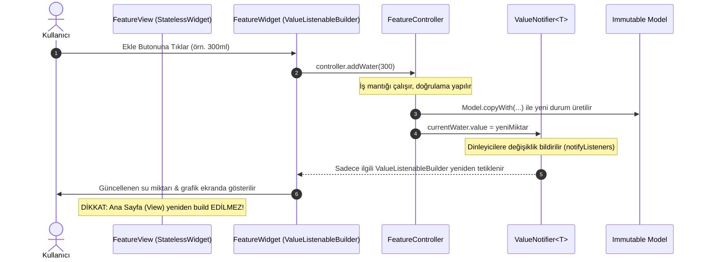

# Susadım & Flutter Feature Scaffold: Reaktif State Akışı ve Mimari Kılavuzu

Bu referans belgesi, **Susadım** (akıllı su, egzersiz ve kalori takibi) projesinde ve `flutter-feature-scaffold` yeteneğinde uygulanan reaktif durum yönetimi (State Management), katmanlı mimari ve performans standartlarını açıklar. Projede yer alan her ekran, widget ve iş mantığı buradaki kurallara ve [`project.md`](file:///Users/d1-22/Desktop/19ekim3/project.md) belgesine uymak zorundadır.

---

## 1. Mimari Vizyon ve Temel İlkeler

Susadım projesinde harici ağır durum yönetimi kütüphaneleri (Bloc, Riverpod, MobX vb.) **kullanılmaz**. Durum yönetimi, Flutter ve Dart'ın yerel çekirdek API'leri olan **`ValueNotifier<T>`** ve **`ValueListenableBuilder<T>`** ile sağlanır.

### Kırmızı Çizgiler (Project.md ve Skill Uyumluluğu)
1. **Sayfa Düzeyinde Ağır `setState` Yasaktır:** 
   Sayfanın tamamını yeniden çizdiren (rebuild) `setState` çağrıları kesinlikle yapılamaz. Yalnızca buton animasyonu veya yerel geçici arayüz durumunu yöneten hafif `StatefulWidget`'lar kabul edilir.
2. **`const` Kullanımı Zorunludur:**
   Statik olarak tanımlanabilen tüm widget, padding, margin ve text stillerinde `const` anahtar kelimesi zorunludur.
3. **40 Satır Kuralı:**
   Tek bir `build` metodunun gövdesi 40 satırı geçemez. 40 satırı aşan veya bağımsız bir işlevi olan parçalar `widgets/` klasörüne bağımsız widget sınıfları olarak taşınmalıdır.
4. **Tema ve Stil Bağımsızlığı:**
   Renkler ve tipografiler doğrudan koda gömülmez (`Color(0xFF...)` yasaktır). Renkler `Theme.of(context)` ve `AppColors` üzerinden, Material 3 uyumlu çift tema paletiyle (**Dark Obsidian & Neon** / **Light Snow & Dinamik Enerji**) kullanılır.
5. **Bellek Temizliği (Dispose Zorunluluğu):**
   Açılan her `ValueNotifier` nesnesi, işi bittiğinde mutlaka `dispose()` edilmelidir.

---

## 2. Reaktif State Akış Şeması (Mermaid)

Aşağıdaki şema, kullanıcı bir etkileşimde bulunduğunda (örneğin 300ml özel içecek eklediğinde) verinin ve arayüzün nasıl güncellendiğini gösterir:



---

## 3. Katman Sorumlulukları (Feature-Based Structure)

Her özellik modülü `lib/features/<feature_name>/` altında 4 ana katmana ayrılır:

```text
lib/features/<feature_name>/
  ├── controllers/
  │   └── <feature_name>_controller.dart  --> İş mantığı, ValueNotifier tanımları ve dispose
  ├── models/
  │   └── <feature_name>_model.dart       --> İmmutable veri modelleri (copyWith, JSON)
  ├── view/
  │   └── <feature_name>_view.dart        --> Sayfa iskeleti (StatelessWidget, Scaffold, <40 satır build)
  └── widgets/
      ├── <feature_name>_card.dart        --> Bağımsız UI kartı
      └── <feature_name>_progress.dart    --> ValueListenableBuilder ile izole reaktif bileşen
```

### 3.1. Model Katmanı (`models/`)
* **İmmutable (Değişmez) Olmalıdır:** Tüm alanlar `final` tanımlanır.
* `const` kurucu metot (constructor) içermelidir.
* Durum değişiklikleri için `copyWith` metodu zorunludur.
* Serileştirme için `fromJson` ve `toJson` metotları bulunmalıdır.

```dart
class WaterIntakeModel {
  final String id;
  final String beverageName;
  final int amountMl;
  final DateTime timestamp;

  const WaterIntakeModel({
    required this.id,
    required this.beverageName,
    required this.amountMl,
    required this.timestamp,
  });

  WaterIntakeModel copyWith({
    String? id,
    String? beverageName,
    int? amountMl,
    DateTime? timestamp,
  }) {
    return WaterIntakeModel(
      id: id ?? this.id,
      beverageName: beverageName ?? this.beverageName,
      amountMl: amountMl ?? this.amountMl,
      timestamp: timestamp ?? this.timestamp,
    );
  }

  factory WaterIntakeModel.fromJson(Map<String, dynamic> json) {
    return WaterIntakeModel(
      id: json['id'] as String? ?? '',
      beverageName: json['beverageName'] as String? ?? 'Su',
      amountMl: json['amountMl'] as int? ?? 0,
      timestamp: json['timestamp'] != null
          ? DateTime.parse(json['timestamp'] as String)
          : DateTime.now(),
    );
  }

  Map<String, dynamic> toJson() => {
    'id': id,
    'beverageName': beverageName,
    'amountMl': amountMl,
    'timestamp': timestamp.toIso8601String(),
  };
}
```

### 3.2. Controller Katmanı (`controllers/`)
* UI'dan tamamen bağımsızdır (`dart:ui` veya `package:flutter/material.dart` UI widget'larına bağımlılık içermez, sadece `package:flutter/foundation.dart` gerektirir).
* Durumları `ValueNotifier<T>` olarak dışa açar.
* İş mantığını (`addWater`, `resetWater`, `addCustomBeverage`) metotlar halinde sunar.
* Tüm `ValueNotifier` nesnelerini `dispose()` metodunda kapatır.

```dart
import 'package:flutter/foundation.dart';
import '../models/water_intake_model.dart';

class WaterTrackerController {
  final ValueNotifier<int> currentWater = ValueNotifier<int>(0);
  final ValueNotifier<List<WaterIntakeModel>> intakeHistory =
      ValueNotifier<List<WaterIntakeModel>>(const []);
  final ValueNotifier<bool> isLoading = ValueNotifier<bool>(false);

  static const int dailyGoalMl = 2000;

  void addWater([int amountMl = 250]) {
    if (amountMl <= 0) return;
    currentWater.value += amountMl;
    _recordIntake('Su', amountMl);
  }

  void addCustomBeverage(String name, int amountMl) {
    if (amountMl <= 0 || name.trim().isEmpty) return;
    currentWater.value += amountMl;
    _recordIntake(name.trim(), amountMl);
  }

  void resetWater() {
    currentWater.value = 0;
    intakeHistory.value = const [];
  }

  void _recordIntake(String name, int ml) {
    final entry = WaterIntakeModel(
      id: DateTime.now().millisecondsSinceEpoch.toString(),
      beverageName: name,
      amountMl: ml,
      timestamp: DateTime.now(),
    );
    intakeHistory.value = [entry, ...intakeHistory.value];
  }

  void dispose() {
    currentWater.dispose();
    intakeHistory.dispose();
    isLoading.dispose();
  }
}
```

### 3.3. View Katmanı (`view/`)
* `StatelessWidget` olarak kodlanır.
* Controller örneğini barındırır.
* Sayfa iskeletini (Scaffold, AppBar, genel Padding ve Layout) çizer.
* `build` metodu 40 satırın altındadır; alt bileşenleri `widgets/` altındaki sınıflara delege eder.

```dart
import 'package:flutter/material.dart';
import '../controllers/water_tracker_controller.dart';
import '../widgets/water_progress_card.dart';
import '../widgets/water_quick_actions.dart';

class WaterTrackerView extends StatelessWidget {
  final WaterTrackerController controller;

  const WaterTrackerView({
    super.key,
    required this.controller,
  });

  @override
  Widget build(BuildContext context) {
    return Scaffold(
      appBar: AppBar(
        title: const Text('Susadım - Su Takibi'),
      ),
      body: SafeArea(
        child: Padding(
          padding: const EdgeInsets.all(16.0),
          child: Column(
            crossAxisAlignment: CrossAxisAlignment.stretch,
            children: [
              WaterProgressCard(controller: controller),
              const SizedBox(height: 16),
              WaterQuickActions(controller: controller),
            ],
          ),
        ),
      ),
    );
  }
}
```

### 3.4. Widget Katmanı (`widgets/`)
* Yalnızca kendi ihtiyacı olan `ValueNotifier`'ı `ValueListenableBuilder` ile dinler.
* Bu sayede sadece bu widget yeniden çizilir; sayfa genelindeki diğer widget'lar korunur.

```dart
import 'package:flutter/material.dart';
import '../controllers/water_tracker_controller.dart';

class WaterProgressCard extends StatelessWidget {
  final WaterTrackerController controller;

  const WaterProgressCard({super.key, required this.controller});

  @override
  Widget build(BuildContext context) {
    final theme = Theme.of(context);

    return Card(
      elevation: 2,
      child: Padding(
        padding: const EdgeInsets.all(20.0),
        child: ValueListenableBuilder<int>(
          valueListenable: controller.currentWater,
          builder: (context, current, _) {
            final progress = (current / WaterTrackerController.dailyGoalMl).clamp(0.0, 1.0);
            final percent = (progress * 100).toInt();

            return Column(
              mainAxisSize: MainAxisSize.min,
              children: [
                Text(
                  '$current / ${WaterTrackerController.dailyGoalMl} ml',
                  style: theme.textTheme.headlineMedium,
                ),
                const SizedBox(height: 12),
                LinearProgressIndicator(
                  value: progress,
                  minHeight: 12,
                  borderRadius: const BorderRadius.all(Radius.circular(6)),
                ),
                const SizedBox(height: 8),
                Text('%$percent tamamlandı', style: theme.textTheme.bodyMedium),
              ],
            );
          },
        ),
      ),
    );
  }
}
```

---

## 4. Çift Tema Yönetimi Akışı (Dark Obsidian & Light Snow)

[`project.md`](file:///Users/d1-22/Desktop/19ekim3/project.md) kuralı gereği, arayüzden tek tıkla **Dark Obsidian & Neon** (Karanlık Mod) ile **Light Snow & Dinamik Enerji** (Aydınlık Mod) arasında geçiş yapılabilmelidir. Bu durum da `ValueNotifier<ThemeMode>` ile yönetilir:

```mermaid
graph LR
    Btn[Tema Butonuna Tıkla] --> Controller[ThemeController.toggleTheme]
    Controller --> Notifier[themeMode.value = (isDark ? Light : Dark)]
    Notifier --> App[ValueListenableBuilder<ThemeMode>]
    App --> MaterialApp[MaterialApp: theme & darkTheme uygulanır]
```

### ThemeController Örneği
```dart
import 'package:flutter/material.dart';

class ThemeController {
  final ValueNotifier<ThemeMode> themeMode = ValueNotifier<ThemeMode>(ThemeMode.dark);

  void toggleTheme() {
    themeMode.value = themeMode.value == ThemeMode.dark ? ThemeMode.light : ThemeMode.dark;
  }

  void dispose() {
    themeMode.dispose();
  }
}
```

---

## 5. Doğrulama ve Test Akışı

Yapılan her değişiklik sonrası [`project.md`](file:///Users/d1-22/Desktop/19ekim3/project.md) bölüm 4 uyarınca aşağıdaki adımlar çalıştırılmalıdır:

1. **Statik Kod Analizi (0 Uyarı, 0 Hata):**
   ```bash
   flutter analyze
   ```
2. **Birim ve Widget Testleri:**
   ```bash
   flutter test
   ```
3. **Uygulamayı Çalıştırma:**
   ```bash
   flutter run
   ```

---

## 6. Anti-Pattern'ler ve Doğru Çözümler Özeti

| Anti-Pattern (YASAK) | Doğru Mimari Yaklaşım (ZORUNLU) | Gerekçe |
| :--- | :--- | :--- |
| Sayfa düzeyinde `setState(() { water += 250; });` | `controller.addWater(250)` ve hedeflenmiş `ValueListenableBuilder` | Tüm sayfa ağacının gereksiz yeniden çizilmesini önler, 60/120 FPS performansı korur. |
| 100+ satırlık devasa `build()` metodu | < 40 satır kuralı ile `widgets/` altına parçalanmış alt widget'lar | Kod okunabilirliği, test edilebilirlik ve `const` optimizasyonu sağlar. |
| Hardcoded renk: `Color(0xFF00FF00)` | `Theme.of(context).colorScheme.primary` | Çift tema (Dark Obsidian / Light Snow) uyumluluğunu garanti eder. |
| Harici ağır state paketi (Bloc/Riverpod) | Yerel Dart & Flutter SDK: `ValueNotifier` / `ChangeNotifier` | Paket şişkinliğini önler, hafif ve native kalır. |
| Dispose edilmeyen `ValueNotifier` | Controller içinde `dispose()` metodunda temizlik | Bellek sızıntılarını (memory leaks) engeller. |
